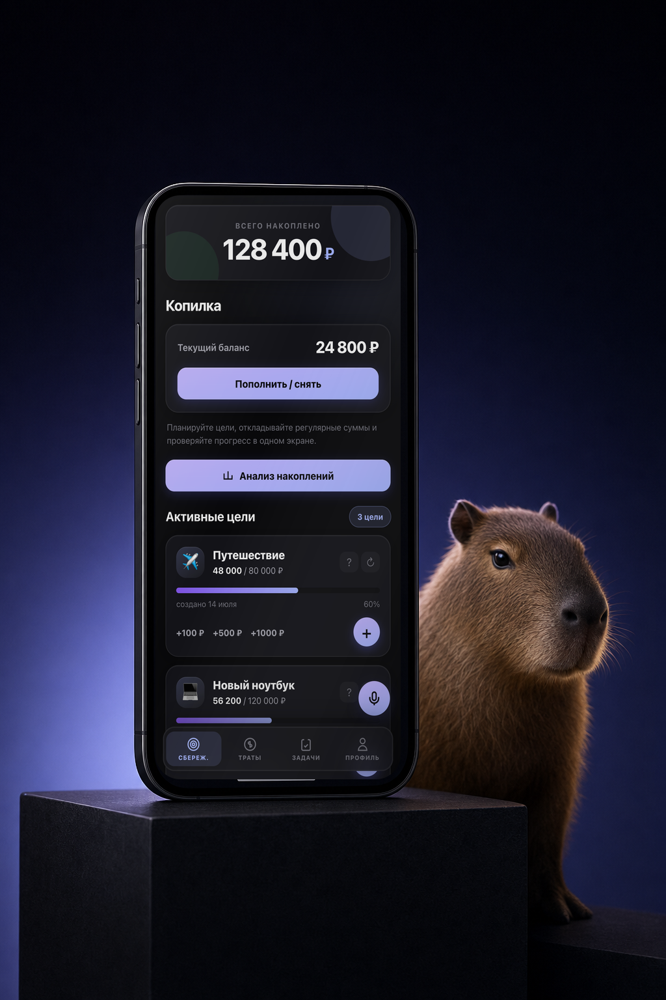
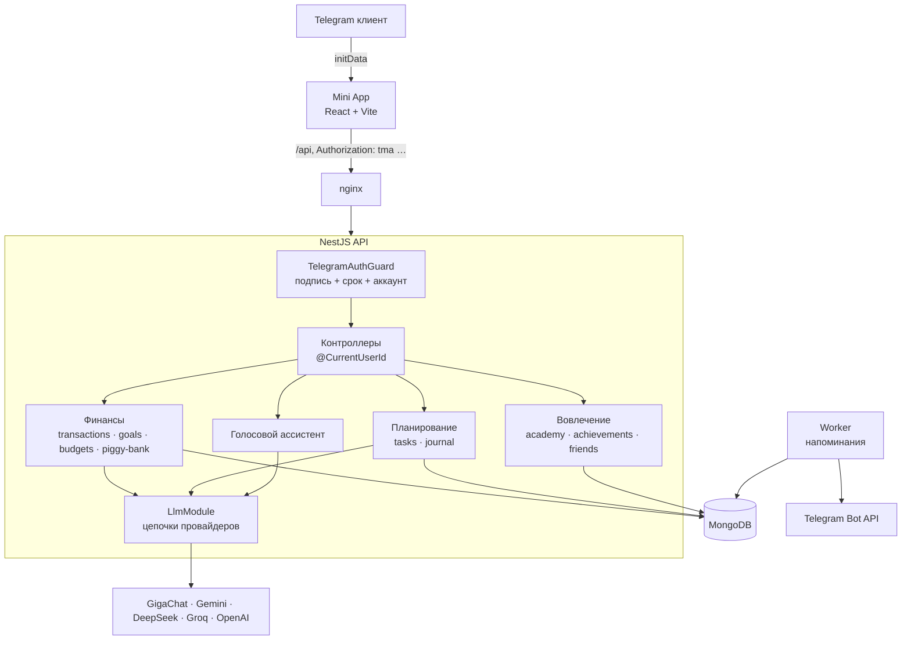

# Capy

[](https://github.com/akoody/Capy/actions/workflows/ci.yml)

Telegram Mini App для личных финансов: кошелёк и цели накоплений, доходы и расходы по категориям, бюджеты, финансовый журнал, задачи с напоминаниями в Telegram, обучающие курсы и голосовой ассистент, который понимает команды вроде «запиши расход 450 на кофе».



**Стек:** NestJS 11, TypeScript (strict), MongoDB + Mongoose, React 19 + Vite + Tailwind, i18next (ru/en), Telegram Web App SDK. AI: GigaChat, Gemini, DeepSeek, Groq, OpenAI (с fallback-цепочкой), распознавание речи через OpenAI / Groq Whisper.

## Архитектура



Бэкенд — модульный монолит на NestJS. Каждый запрос проходит один и тот же путь:

1. **`TelegramAuthGuard`** проверяет HMAC-подпись `initData` от Telegram за постоянное время, отклоняет просроченные данные и атомарно находит или создаёт аккаунт.
2. **Контроллер** получает владельца только через `@CurrentUserId()`. Id пользователя из query, body или params для этого не используется.
3. **Сервис** принимает `userId` первым аргументом. Все запросы по `:id` фильтруются через `ownedBy(userId, id)`, поэтому чужая запись неотличима от несуществующей (404).
4. **AI-функции** ходят через `LlmService`: один типизированный адаптер на провайдера и цепочка fallback под задачу (`analysis` для текстовых разборов, `interpret` для голосовых команд в JSON).

Подробнее: [docs/architecture.md](docs/architecture.md). Почему сделано именно так: [журнал решений](docs/adr/README.md).

## Ключевые решения

| ADR | Решение |
|---|---|
| [0001](docs/adr/0001-validate-config-at-startup.md) | Конфигурация проверяется zod-схемой при старте: процесс падает сразу, а не на первом запросе |
| [0002](docs/adr/0002-telegram-init-data-guard.md) | Аутентификация — глобальный guard по initData с TTL вместо middleware |
| [0003](docs/adr/0003-owner-scoped-data-access.md) | Владелец данных берётся только из подписи, доступ к записям — через `ownedBy` |
| [0004](docs/adr/0004-llm-provider-chains.md) | Все AI-провайдеры за одним модулем с цепочками fallback |
| [0005](docs/adr/0005-keep-mongodb.md) | Остаёмся на MongoDB, деньги хранятся целыми в копейках, операции атомарны |
| [0006](docs/adr/0006-quality-gates.md) | Strict TypeScript, линтер без warning, e2e на реальной базе в CI |
| [0007](docs/adr/0007-worker-without-queue.md) | Фоновые задачи в отдельном процессе с атомарным захватом в MongoDB, без Redis |

## Качество

- **Тесты:** 85 unit-тестов (проверка initData, guard, конфиг, LLM-цепочки и адаптеры с подменой HTTP) и 30 e2e-сценариев на настоящей MongoDB, где второй пользователь пытается прочитать, изменить и удалить данные первого.
- **CI** ([ci.yml](.github/workflows/ci.yml)): Prettier, ESLint (`recommendedTypeChecked`, `--max-warnings=0`), typecheck, unit-тесты и сборка API; e2e с сервисом `mongo:7`; сборка фронта.
- **Ревью через PR:** каждое изменение — отдельный PR с описанием проблемы, решения и того, что сознательно отложено ([история](https://github.com/akoody/Capy/pulls?q=is%3Apr+is%3Amerged)).

## Запуск локально

Нужны Node.js 22 и MongoDB в режиме replica set: операции с кошельком идут в транзакциях.

```bash
cp .env.example .env              # минимум: MONGODB_URI (replica set) и TELEGRAM_BOT_TOKEN
npm ci --legacy-peer-deps
npm run seed                      # курсы академии
npm run start:dev                 # API на :3001
npm run start:worker:dev          # напоминания

cd frontend && npm ci && npm run dev   # Mini App, проксирует /api на :3001
```

Mini App открывается из бота (кнопка или menu button), иначе Telegram не передаст `initData`.

Проверки, которые запускает CI:

```bash
npm run format:check && npm run lint && npm run typecheck
npm test
MONGODB_TEST_URI=mongodb://127.0.0.1:27017 npm run test:e2e   # каждая прогонка в отдельной базе
```

### Переменные окружения

| Переменная | Обязательна | Назначение |
|---|---|---|
| `MONGODB_URI` | да | Подключение к MongoDB |
| `TELEGRAM_BOT_TOKEN` | да | Проверка подписи initData и отправка напоминаний |
| `TELEGRAM_AUTH_MAX_AGE_SECONDS` | нет | Срок жизни initData, по умолчанию сутки |
| `CORS_ORIGINS` | нет | Список origin через запятую; пусто — CORS выключен (фронт и API на одном домене) |
| `GIGACHAT_API_KEY`, `GEMINI_API_KEY`, `DEEPSEEK_API_KEY`, `GROQ_API_KEY` | хотя бы один | AI-разборы финансов и журнала |
| `OPENAI_API_KEY` | нет | Распознавание речи и разбор голосовых команд (запасной вариант — Groq) |
| `GIGACHAT_CA_CERT_PATH` | нет | Корневой сертификат Минцифры для проверки TLS GigaChat |

Полный список с комментариями: [.env.example](.env.example).

## Структура

```
src/
  auth/          проверка initData, guard, @CurrentUserId
  config/        zod-схема окружения
  common/        ownedBy и другие общие правила доступа
  llm/           LlmService и адаптеры провайдеров
  transactions/ goals/ budgets/ piggy-bank/   финансы
  tasks/ journal/                              планирование и заметки
  academy/ achievements/ gamification/ friends/ tips/
  assistant/     голосовой ассистент: распознавание, разбор, выполнение
  users/ telegram/
test/            e2e на MongoDB
frontend/        Mini App
docs/            архитектура и журнал решений
```

## Дальше

- **Эксплуатация:** Docker и compose вместо pm2-скриптов, health-check, структурные логи, OpenAPI.

## Лицензия

Проприетарная, см. [LICENSE](LICENSE). Код открыт для ознакомления.
