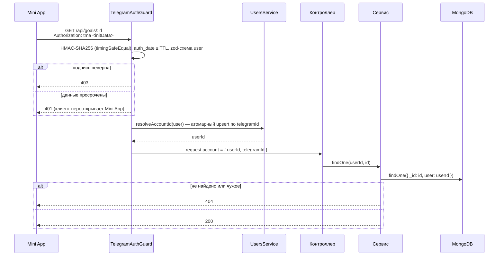
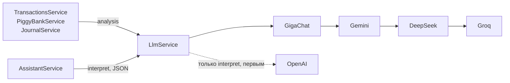

# Архитектура Capy

## Обзор

Capy — Telegram Mini App. Фронт (React + Vite) отдаётся nginx как статика, запросы к `/api` nginx проксирует в NestJS API на том же домене. Данные лежат в MongoDB. AI-функции обращаются к внешним LLM-провайдерам, напоминания уходят через Telegram Bot API.

## Модули

| Контекст | Модули | Что делает |
|---|---|---|
| Идентичность | `auth`, `users` | Проверка initData, аккаунт, профиль `/users/me` (менять можно только валюту и язык) |
| Финансы | `transactions`, `goals`, `budgets`, `piggy-bank` | Доходы и расходы по категориям, цели накоплений, бюджеты, кошелёк |
| Планирование | `tasks`, `journal`, `telegram` | Задачи с напоминаниями, финансовый журнал, отправка сообщений ботом |
| Вовлечение | `academy`, `achievements`, `gamification`, `friends`, `tips` | Курсы и уроки, достижения и очки, лидерборд, друзья, советы |
| AI | `llm`, `assistant` | Цепочки LLM-провайдеров, голосовые команды |
| Инфраструктура | `config`, `common` | Схема окружения, правила доступа к данным |

Модули общаются через сервисы друг друга, а не через чужие Mongoose-модели. Единственное исключение: `transactions` читает коллекцию целей, чтобы проверить, что цель транзакции принадлежит тому же пользователю.

## Правила доступа

- Владелец берётся только из `request.account`, который заполняет guard. В DTO нет полей `userId`/`user`; `ValidationPipe({ whitelist: true })` отбрасывает их, если клиент всё же пришлёт.
- Сервисы принимают `userId` первым аргументом. Запросы по id идут через `ownedBy(userId, id)`, который заодно отсекает некорректные ObjectId (404 вместо 500 от CastError).
- Наружу отдаются только публичные поля других пользователей (лидерборд, друзья): `firstName`, `username`, `photoUrl`, `points`.
- Суммы — только положительные (`@IsPositive`). Направление операции задаёт маршрут, а не знак суммы. Кошелёк меняется атомарным `$inc`, списание идёт с условием `amount >= x` в том же запросе.

Подробнее: [ADR-0002](adr/0002-telegram-init-data-guard.md), [ADR-0003](adr/0003-owner-scoped-data-access.md).

## AI

- Каждый провайдер — адаптер `LlmProvider` с типизированным ответом. OpenAI, DeepSeek и Groq используют один `OpenAiCompatibleProvider`.
- `LlmService.complete(prompt, options, purpose)` пробует настроенных провайдеров по порядку и, если не ответил никто, бросает `LlmUnavailableError` со списком отказов.
- GigaChat кэширует OAuth-токен до истечения и сбрасывает его после 401/403. TLS проверяется, если задан `GIGACHAT_CA_CERT_PATH`.
- Лимиты: 3 анализа одного типа за 2 часа на пользователя, отдельный лимит на голосовые команды.

Голосовая команда: аудио → нормализация (ffmpeg) → распознавание (OpenAI, запасной — Groq Whisper) → разбор в JSON-пакет операций через цепочку `interpret` → проверка → выполнение через сервисы финансов, задач и журнала от имени того же `userId`.

Подробнее: [ADR-0004](adr/0004-llm-provider-chains.md).

## Фоновые задачи

`TasksReminderScheduler` раз в минуту находит задачи с наступившим напоминанием и отправляет сообщение через Bot API. Сейчас cron живёт в процессе API, поэтому API запускается в одном экземпляре. Перенос в отдельный worker с очередью — в планах (см. README, раздел «Дальше»).

## Конфигурация и запуск

Окружение валидируется zod-схемой (`src/config/env.schema.ts`) при импорте `AppModule`. При ошибке процесс падает со списком неверных переменных, значения секретов в сообщение не попадают ([ADR-0001](adr/0001-validate-config-at-startup.md)). Сидер проверяет только `MONGODB_URI` и пересоздаёт только контент академии.
